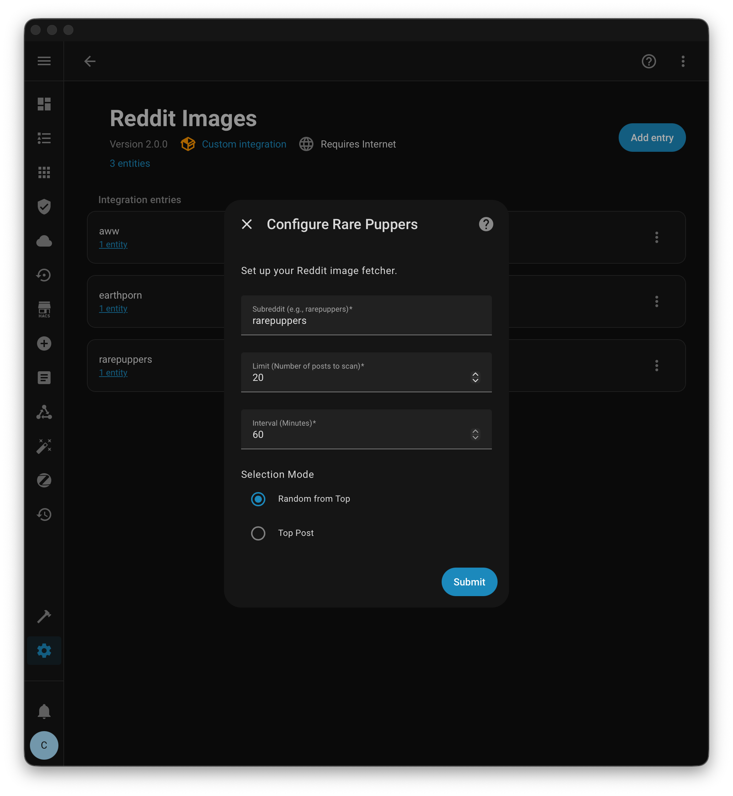
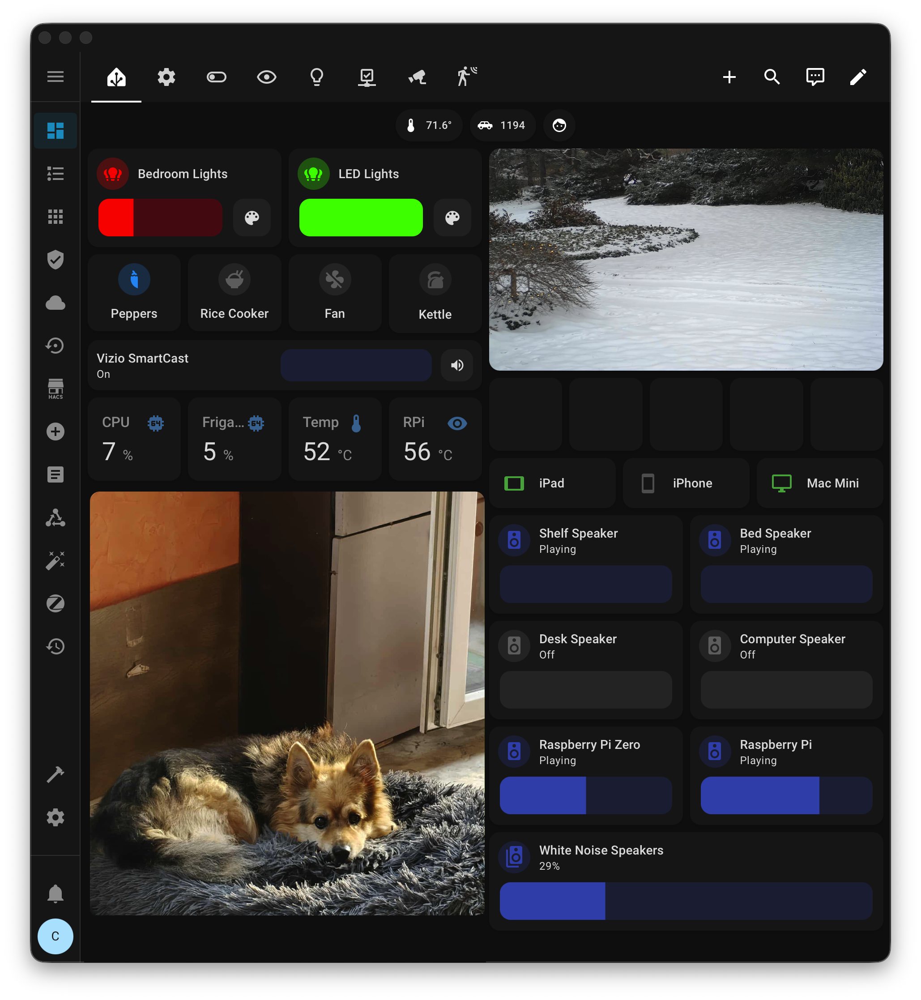
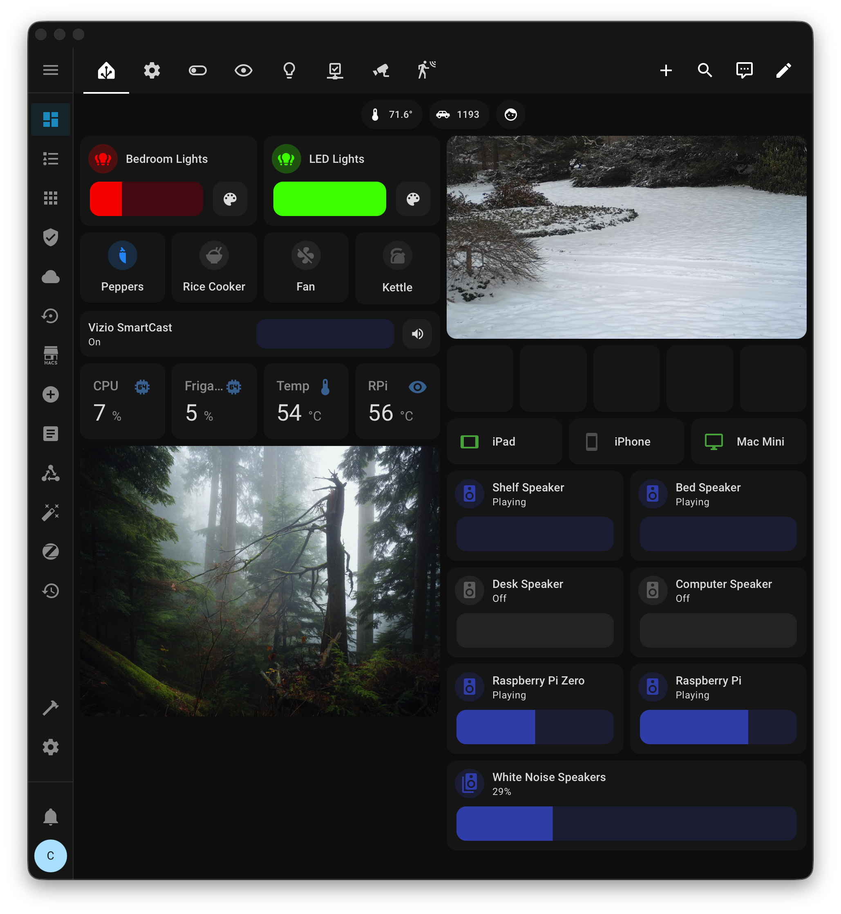
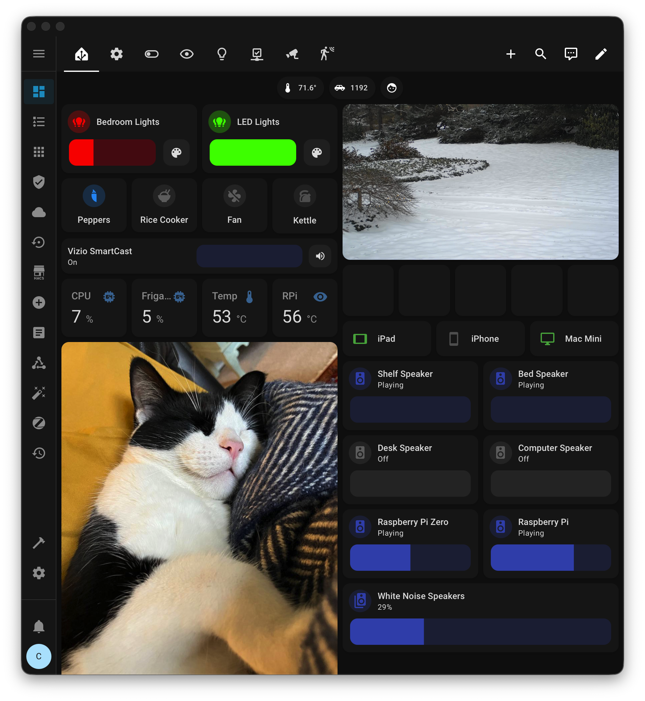

# Reddit Images

<a href="https://my.home-assistant.io/redirect/marketplace_repository/?owner=saihgupr&repository=reddit_images&category=integration">
  
</a>

## About

Reddit Images is a Home Assistant integration that displays the top images from any subreddit on your dashboard. Point a `picture-entity` card at the generated `image` entity and you get a rotating photo frame that updates on its own.

## Screenshots






## Features

- Display images from any public subreddit
- Two selection modes: random from the top posts, or always the top post of the day
- Configurable scan depth and refresh interval
- Works with the `picture-entity` card out of the box
- Add the integration multiple times for separate entities per subreddit
- Reads Reddit's public Atom/RSS feeds, so no account, API key, or token is needed
- Brand icons included, so it shows up correctly in the Marketplace and in Devices & Services

## Installation

### Marketplace (recommended, Home Assistant 2026.11 and newer)

1. Go to **Settings** → **Marketplace**
2. Search for **Reddit Images**
3. Open the result and select **Download**
4. Home Assistant continues straight into the setup flow. If it does not, go to **Settings** → **Devices & services** → **Add integration** and search for **Reddit Images**

No restart needed.

### HACS (Home Assistant 2026.10 and older)

<a href="https://my.home-assistant.io/redirect/hacs_repository/?owner=saihgupr&repository=reddit_images&category=integration">
  
</a>

**Or manually add the custom repository:**

1. Open HACS in Home Assistant
2. Click the **three dots menu** (⋮) in the top right corner
3. Select **Custom repositories**
4. Enter the repository URL: `https://github.com/saihgupr/reddit_images`
5. Select **Integration** as the category
6. Click **Add**
7. Search for "**Reddit Images**" in HACS and click **Download**
8. Restart Home Assistant

HACS was merged into Home Assistant as the Marketplace in 2026.11. Everything installed through HACS carries over automatically.

### Manual Installation

1. Download the `reddit_images` folder from this repository
2. Copy it to your `custom_components` directory
3. Restart Home Assistant

## Configuration

1. Go to **Settings** → **Devices & services**
2. Click **Add integration**
3. Search for "Reddit Images"
4. Configure:
   - **Subreddit**: The subreddit to pull images from (e.g., `rarepuppers`, `earthporn`, `aww`)
   - **Limit**: Number of top posts to consider (default: 20)
   - **Interval (Minutes)**: How often to fetch a new image (default: 60)
   - **Selection Mode**:
     - *Random from Top*: Randomly picks an image from the top posts
     - *Top Post*: Always shows the #1 highest-upvoted image

**Tip**: You can add the integration multiple times to create separate entities for different subreddits.

## Usage

Add a `picture-entity` card to your Lovelace dashboard:

```yaml
type: picture-entity
entity: image.reddit_images_rarepuppers
show_name: false
show_state: false
```

Replace `rarepuppers` with your configured subreddit name.

## How It Works

1. Fetches the top posts from the configured subreddit (last 24 hours) via the public `.rss` feed
2. Extracts the highest resolution image from each post, preferring direct `i.redd.it` links and falling back to preview images
3. Handles single image posts, gallery posts, and video thumbnails, including `.jpg`, `.jpeg`, `.png`, `.gif`, and `.webp`
4. Selects an image based on your chosen mode (random or top)
5. Downloads it and refreshes at your configured interval

Reddit returns `403 Forbidden` for unauthenticated `.json` requests, which is why the integration uses the public Atom/RSS feeds instead. No credentials or API keys are required.

## Supported Subreddits

Any public subreddit with image posts. Popular choices:
- `rarepuppers` - Adorable dogs
- `aww` - Cute animals
- `earthporn` - Beautiful landscapes (SFW)
- `spaceporn` - Space and astronomy images
- `itookapicture` - Photography

## Troubleshooting & Debugging

- **No image displayed**: Verify the subreddit has public image submissions and is spelled correctly. Subreddits with text-only posts will not produce images.
- **Image does not refresh immediately**: The integration updates according to the configured interval (default 60 minutes).
- **Enable Debug Logging**: To see detailed fetch and parsing logs, add the following to your `configuration.yaml` and restart Home Assistant:

```yaml
logger:
  default: info
  logs:
    custom_components.reddit_images: debug
```

## Contributing

Contributions are welcome! If you'd like to contribute:

1. Fork the repository
2. Create a feature branch (`git checkout -b feature/my-new-feature`)
3. Commit your changes
4. Push to the branch (`git push origin feature/my-new-feature`)
5. Open a Pull Request

## Support & Feedback

Found a bug or have a suggestion? Please [open an issue](https://github.com/saihgupr/reddit_images/issues) to report it.

If you like this integration, please give it a star on GitHub!

[](https://ko-fi.com/saihgupr)

## License

[MIT License](LICENSE) © 2026 Saihgupr
